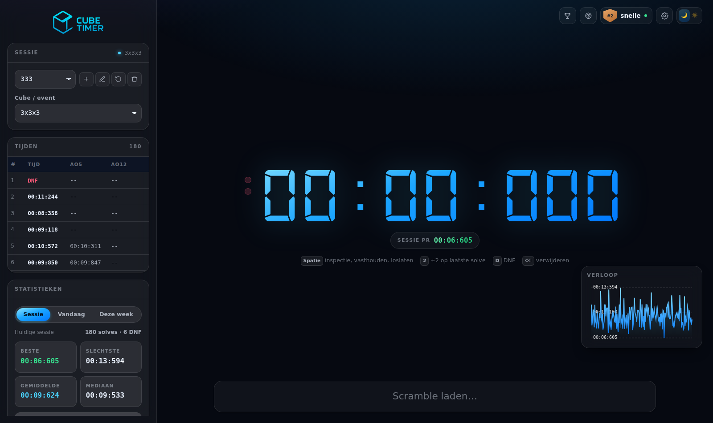
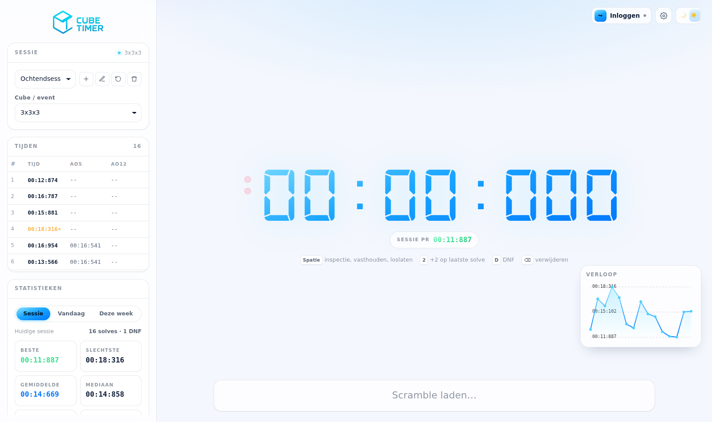
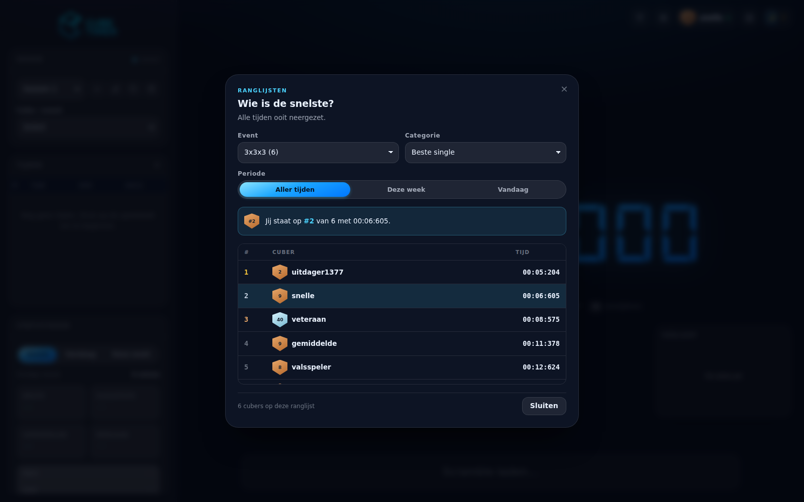
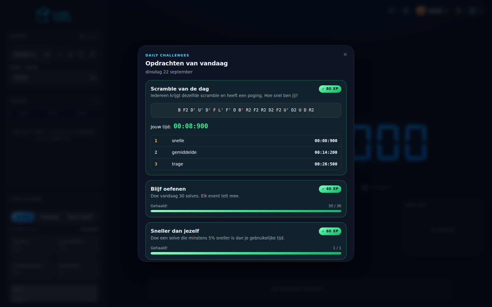
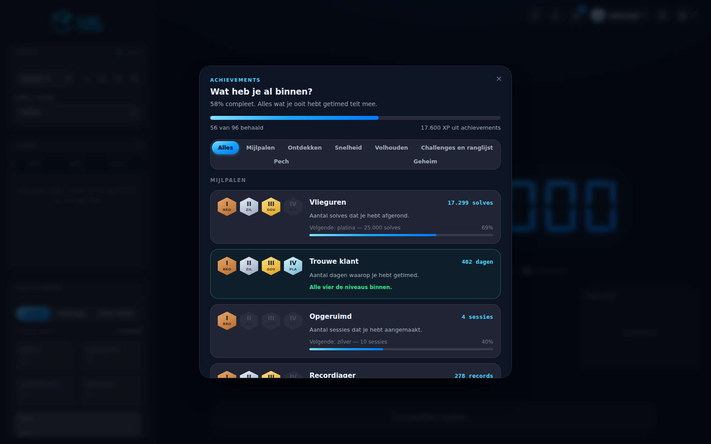
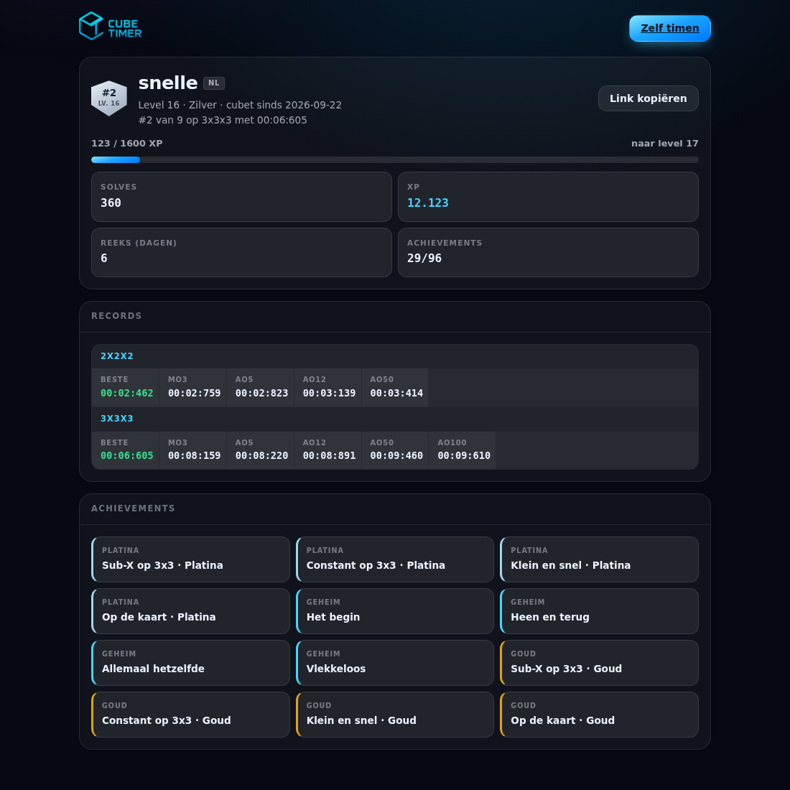
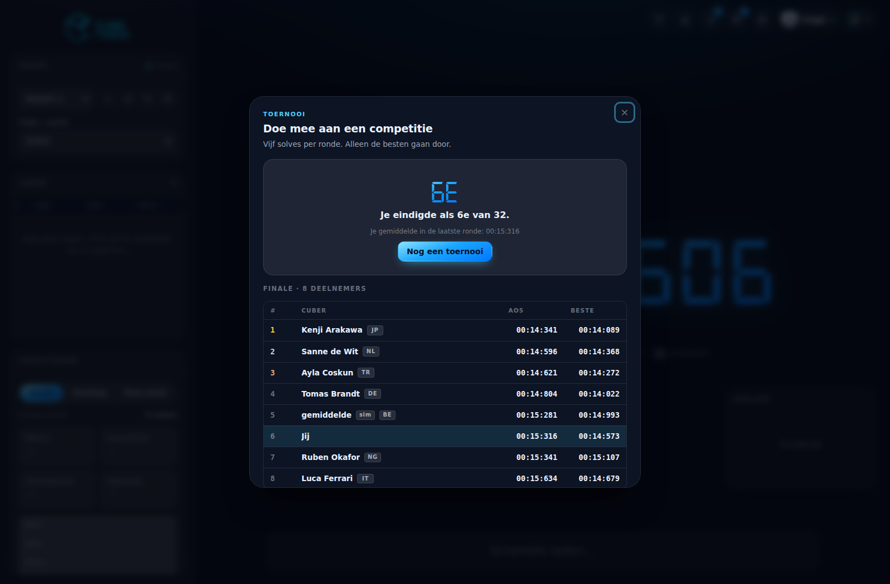

<div align="center">


**Een rustige, snelle speedcubing-timer voor in je browser.**

Officiële WCA-scrambles · inspectietijd · sessies · statistieken · smart cubes
· ranglijsten · toernooien · spelmodi · achievements · gidsen

[**cubetimer.nl**](https://cubetimer.nl) · [English](https://cubetimer.nl/en/) · [Roadmap](https://github.com/frocky10/cubetimer.nl/issues) · [Handboek](docs/ontwikkelen.md)

<sub>A free speedcubing timer with official WCA scrambles, smart cube support, leaderboards and tournaments, in Dutch and English.</sub>

</div>

---



<details>
<summary>Meer screenshots</summary>

**Het lichte thema**



**De ranglijsten**



**De daily challenges**



**De achievements**



**Een openbaar profiel**



**De toernooimodus**



</details>

---

## Wat is het

CubeTimer is een timer voor speedcubers. Geen account nodig, geen installatie:
je opent de site en drukt op de spatiebalk. Je tijden blijven in je browser
staan en de timer werkt ook zonder internet.

Met een gratis account neem je je tijden mee naar een ander apparaat, kom je op
de ranglijsten, verdien je XP en achievements, doe je elke dag de scramble van
de dag en neem je het in de toernooimodus op tegen een heel deelnemersveld.

## Wat het kan

**Timen**
- Spatiebalk (indrukken, vasthouden tot groen, loslaten) of een tik op je scherm
- WCA-inspectie van 15 seconden, met automatische +2 en DNF
- Officiële random-state scrambles voor alle 17 WCA-events, plus FTO en Master Tetraminx, via [cubing.js](https://cubing.net) op de eigen server

**Je tijden**
- Sessies met elk een eigen event, en Ao5 en Ao12 bij elke solve
- Statistieken per sessie, per dag en per week: Mo3, Ao5, Ao12, Ao50 en Ao100, beste, slechtste en mediaan
- Een grafiek van je verloop, en confetti bij een record
- Een sessie of solve weggooien kost je geen tijden op je account; losse tijden zijn terug te halen

**Smart cubes**
- GAN (gen1 t/m gen4), QiYi/X-Man, MoYu, Giiker en GoCube, via Web Bluetooth in Chrome en Edge
- De scramble licht zet voor zet op, de timer start bij je eerste draai en stopt als de cube opgelost is
- De tijd komt uit de klok in de cube, niet uit de wisselende Bluetooth-vertraging
- Per solve: zetten, TPS en de tijd per fase (kruis, F2L, OLL, PLL)

**Samen**
- Ranglijsten per event en per soort gemiddelde, over alle tijd, deze week of vandaag, ook alleen met wie je volgt
- XP, levels, streaks en een rangbadge
- Daily challenges, met een scramble van de dag die voor iedereen gelijk is
- 120 achievements in vier niveaus, plus zestien geheime
- Openbare profielen op `/u/naam`, deelbaar in WhatsApp en Discord
- Volgen en vrienden, en duels op dezelfde scrambles

**Toernooien en spelmodi**
- Een gesimuleerde WCA-competitie met drie rondes, cutoff en tijdslimiet, in zes moeilijkheidsgraden
- Een echte afgelopen WCA-competitie naspelen, tegen de echte deelnemers en hun tijden van toen
- Streak, survival, ladder en speedrun, met een record per modus

**Leren**
- De beginnersmethode, F2L en alle 57 OLL- en 21 PLL-algoritmes, met plaatjes die uit de zetten zelf berekend worden
- Een oefenknop die de timer opent met precies dat geval opgezet
- Acht gidsen: notatie, van beginner naar CFOP, sneller worden, gemiddelden, goede tijden, je eerste wedstrijd, een speedcube kiezen en de WCA-events

**De site zelf**
- Helemaal in het Nederlands en het Engels (`/en/`)
- Donker en licht thema, werkt op telefoon, tablet en desktop
- Advertenties en statistieken pas na toestemming; lettertype en scramblecode op de eigen server
- Je gegevens downloaden en je account verwijderen, met één klik
- Botbescherming zonder captcha of derde partij

## Zo werkt het timen

| Toets | Wat het doet |
|---|---|
| `Spatie` | Start de inspectie. Daarna indrukken en vasthouden tot de lampjes groen worden, loslaten om te starten. Nogmaals indrukken stopt de timer. |
| `2` | Zet een +2 op je laatste solve, of haalt hem er weer af |
| `D` | Markeert je laatste solve als DNF |
| `⌫` | Verwijdert je laatste solve |
| Tik op het scherm | Hetzelfde als de spatiebalk, op telefoon en tablet |

Klik op een rij in de tabel om een oudere solve aan te passen of de scramble
terug te zien.

---

## Zelf draaien

Je hebt alleen PHP 8.1 of nieuwer nodig. Zonder database werken de timer, de
scrambles, de sessies en de statistieken gewoon; de account- en meldknop
verbergen zichzelf.

```bash
git clone https://github.com/frocky10/cubetimer.nl.git
cd cubetimer.nl
php -S 127.0.0.1:8123 -t public_html
```

Open <http://127.0.0.1:8123>.

Wil je ook accounts testen, zet dan een MySQL of MariaDB op, importeer de
bestanden uit `database/` op volgorde, en leg een `cubetimer_config.php` neer
één map boven `public_html`. Zie [`database/README.md`](database/README.md).

## Installeren op je eigen hosting

Bedoeld voor shared hosting met DirectAdmin, maar het werkt op elke server met
PHP 8.1, MySQL en Apache of LiteSpeed.

1. **Bestanden**: zet de inhoud van `public_html/` in je webroot. Of laat de
   GitHub Action het doen: push naar de branch `Release` en vul de secrets
   `FTP_HOST`, `FTP_USER`, `FTP_PASS` en `FTP_PORT` in.
2. **Database**: maak een database aan en importeer de bestanden uit
   `database/` op volgorde ([uitleg](database/README.md)).
3. **Configuratie**: kopieer `public_html/api/config.example.php` naar
   `~/cubetimer_config.php`, dus één map **boven** je webroot. Vul je
   databasegegevens in en bij `security.app_key` een lange willekeurige string
   (`php -r "echo bin2hex(random_bytes(32));"`). Voor wachtwoord vergeten en
   e-mail bevestigen vul je een mailbox in onder `mail`. De deploy komt nooit
   aan dit bestand.
4. **Meldknop** (optioneel): een
   [fine-grained token](https://github.com/settings/personal-access-tokens) met
   alleen *Issues: read and write* op je repo. Laat je hem leeg, dan verdwijnt
   de knop vanzelf.
5. **Toestemming**: zet in AdSense onder *Privacy en berichten* het bericht
   voor de Europese regelgeving aan. Zonder dat venster laadt Google Analytics
   nooit.
6. **Controleren**: `/api/status.php` laat zien welke onderdelen aanstaan, en
   `/api/lib/Auth.php` moet een 403 of 404 geven.

## Hoe het in elkaar zit

Geen build, geen bundler, geen framework, geen `node_modules`. Gewone HTML, CSS
en JavaScript in de browser, en een kleine PHP-API met prepared statements.

| Map | Wat erin zit |
|---|---|
| `public_html/` | Precies wat er op de server komt te staan |
| `public_html/Script/` | De frontend, één bestand per onderwerp |
| `public_html/Style/style.css` | Eén design system, met alle kleuren en maten als tokens bovenaan |
| `public_html/api/` | De PHP-backend: accounts, synchronisatie, ranglijsten, toernooien |
| `public_html/gidsen/`, `en/` | De gidsen en de Engelse site |
| `database/` | Genummerde SQL-migraties, met uitleg per stap |
| `taal/en/` | Alle Engelse teksten; `tools/vertalen.php` bouwt er de Engelse site mee |
| `tools/` | Controle- en hulpscripts; gaan niet mee met de deploy |

Er is geen testframework, wel een set controles die je na een wijziging draait:

```bash
php tools/veiligheid-controleren.php   # geheimen, CSRF, SQL, cookies, headers
php tools/seo-controleren.php          # titels, canonicals, hreflang, sitemap
php tools/vertalen.php --controleer    # elke tekst heeft een Engelse vertaling (PHP 8.4)
node tools/algoritmes-controleren.js   # elk OLL-, PLL- en F2L-algoritme klopt
node tools/smartcube-testen.js         # smart-cubedrivers tegen nagebootste cubes
php tools/spelmodi-en-wca-testen.php   # spelmodi, rangschikking, WCA-gegevens
```

Wil je iets aanpassen, lees dan eerst het [handboek](docs/ontwikkelen.md). Daar
staat hoe alles samenhangt, welke afspraken er gelden en waarom dingen zijn
zoals ze zijn.

## Iets gevonden?

Gebruik de meldknop rechtsboven op de site: je melding komt dan meteen als
issue binnen, met je browser en schermformaat erbij. Een
[issue aanmaken](https://github.com/frocky10/cubetimer.nl/issues/new) mag
natuurlijk ook. Meldingen zijn openbaar, dus zet er geen persoonlijke gegevens
in.

## Licentie

De code van CubeTimer zelf valt niet onder een open-sourcelicentie: je mag
meekijken en ervan leren, maar niet de site of delen ervan overnemen. Alle
rechten voorbehouden.

Wat er van anderen in zit, valt onder hun eigen licentie:

| Onderdeel | Licentie |
|---|---|
| [cubing.js](https://github.com/cubing/cubing.js) (`Script/vendor/cubing/`) | MPL-2.0 |
| [aes-js](https://github.com/ricmoo/aes-js) (`Script/vendor/aes.js`) | MIT |
| De GAN-protocollen in `smartcube-protocols.js`, naar [gan-web-bluetooth](https://github.com/afedotov/gan-web-bluetooth) | MIT |
| Het lettertype [Inter](https://rsms.me/inter/) | SIL Open Font License |
| Het lettertype Digital-7 | De voorwaarden van de maker (Style-7) |

Wedstrijdgegevens van de historische toernooien komen van de
[World Cube Association](https://www.worldcubeassociation.org).
